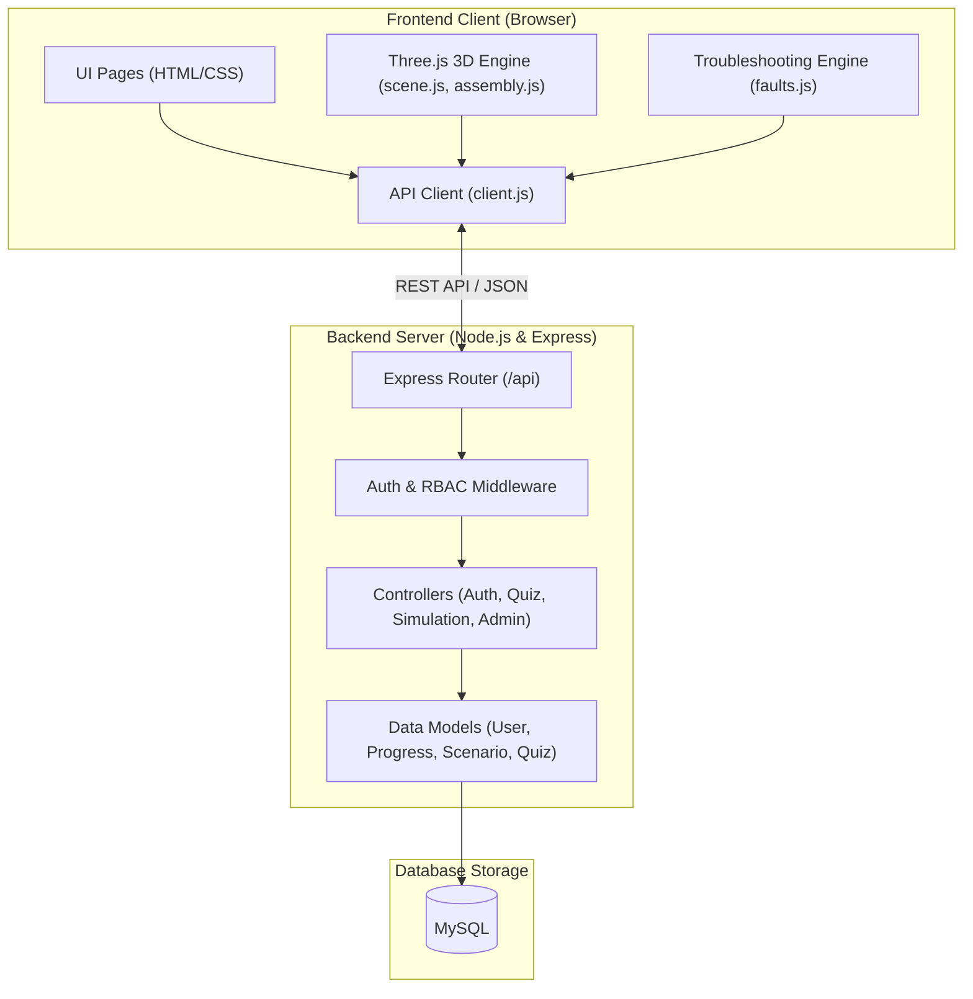

# PC-CRAFT: Interactive 3D PC Building Simulation & Troubleshooting Platform


**PC-CRAFT** is an interactive, web-based educational platform designed for learning computer hardware architecture, practicing hands-on 3D PC assembly, diagnosing real-world hardware/software faults, and taking structured learning modules and quizzes.

The system features real-time 3D rendering with component snapping, collision detection, compatibility verification, and interactive troubleshooting scenarios, backed by role-based access control (Student, Instructor, Admin) and progress tracking.

---

## 🛠️ Project Tech Stack

### **Frontend (Client)**
* **Core Technologies**: HTML5, Modern Semantic CSS3 (Flexbox/Grid, CSS Custom Properties), Modular JavaScript (ES6+).
* **3D Graphics & Simulation**:
  * **[Three.js](https://threejs.org/)** (WebGL/WebGPU Rendering Engine).
  * **OrbitControls**: Smooth camera orbit, panning, zooming, and focal framing.
  * **GLTFLoader / DRACOLoader**: Optimized loading of 3D computer component models (`.glb` / `.gltf`).
  * **Raycasting & Collision Detection**: Interactive component picking, target slot highlight, socket compatibility check, and snap-to-place assembly.
* **Architecture**: Vanilla ES6 modules with decoupled modules for UI, authentication, API client services, 3D scenes, and troubleshooting logic.

### **Backend (Server)**
* **Runtime**: **Node.js** (v22+).
* **Framework**: **Express.js** (RESTful API architecture).
* **Authentication & Security**:
  * **Bearer sessions**: Expiring sessions with token digests stored in MySQL.
  * **scrypt**: Salted password hashing.
  * **CORS & Helmet**: Security headers and cross-origin resource control.
* **Architecture**: Layered MVC pattern:
  * `routes/`: Express endpoint routing.
  * `controllers/`: Business logic and request/response orchestration.
  * `models/`: Database entity definitions and queries.
  * `middleware/`: Auth verification, Role-Based Access Control (RBAC), and centralized error handling.
  * `services/`: Reusable utility functions (scoring, logging, compatibility algorithms).

### **Database & Storage**
* **Database Engine**: **MySQL**.
* **Data Management**:
  * Raw relational schema (`database/schema.sql`).
  * Migration scripts (`database/migrations/`).
  * Seed data for initial modules, quizzes, and troubleshooting scenarios (`database/seeds/`).
* **Assets**:
  * Low-to-mid poly 3D assets in glTF 2.0 binary (`.glb`) format.
  * PBR textures (Albedo, Normal, Roughness, Metalness) for realistic hardware rendering.

### **Testing & DevOps**
* **Testing**:
  * Server unit & integration testing: Node test runner with MySQL (`server/test/`).
  * Client UI & simulation testing: **Vitest** / **Playwright** (`tests/client/`).
* **Environment**: Server configuration in `.env` (`.env.example`).
* **Agentic Support**: Custom AI workflow guidelines (`.agents/README.md`).

---

## 🏛️ System Architecture



---

## 📁 Directory Structure

```text
pc-craft/
├── .agents/                                # AI agent guides and project rules
│   └── README.md
├── .env.example                            # Template for environment variables
├── .gitignore                              # Git exclusion rules
├── client/                                 # Frontend client application
│   ├── index.html                          # Landing page / portal entry
│   ├── pages/                              # UI page views
│   │   ├── login.html                      # User login
│   │   ├── register.html                   # Account registration
│   │   ├── dashboard.html                  # Student overview & stats
│   │   ├── modules.html                    # Learning modules catalog
│   │   ├── quiz.html                       # Interactive quiz interface
│   │   ├── simulation.html                 # 3D PC assembly sandbox
│   │   ├── troubleshooting.html            # Diagnostic & fault-finding simulation
│   │   ├── progress.html                   # Progress reports & certificates
│   │   ├── instructor.html                 # Instructor course management portal
│   │   └── admin.html                      # System admin dashboard
│   ├── css/
│   │   └── styles.css                      # Global and component stylesheets
│   ├── js/
│   │   ├── app.js                          # Core application bootstrap
│   │   ├── auth.js                         # Session handling & token storage
│   │   ├── api/
│   │   │   └── client.js                   # Fetch API wrapper for backend endpoints
│   │   ├── simulation/
│   │   │   ├── scene.js                    # Three.js scene, lights, camera & renderer
│   │   │   └── assembly.js                 # PC parts snapping, sockets & assembly logic
│   │   └── troubleshooting/
│   │       ├── troubleshooting.js          # Diagnostic workflows & interactive checks
│   │       └── faults.js                   # Fault definitions & symptom triggers
│   └── assets/
│       ├── ui_design/                  # UI wireframe mockups and screen references
│       ├── images/
│       │   └── logos/                      # Branding, UI icons & logos
│       ├── models/
│       │   └── glb/                        # 3D GLB component models (CPU, GPU, Case, etc.)
│       └── textures/                       # PBR material textures
├── database/                               # Database schemas, migrations, and seeds
│   ├── schema.sql                          # Primary relational schema definitions
│   ├── migrations/                         # Incremental database migrations
│   └── seeds/                              # Default seeds (admin user, modules, quizzes)
├── docs/                                   # Project documentation
│   ├── diagrams/                           # ERDs, wireframes, sequence diagrams
│   └── requirements/                       # SRS and technical specifications
├── server/                                 # Backend REST API server
│   ├── server.js                           # Express app entry point
│   ├── config/
│   │   └── db.js                           # Database connection pool setup
│   ├── routes/                             # API route definitions
│   │   ├── auth.routes.js                  # /api/auth
│   │   ├── module.routes.js                # /api/modules
│   │   ├── quiz.routes.js                  # /api/quizzes
│   │   ├── simulation.routes.js            # /api/simulation
│   │   ├── troubleshooting.routes.js       # /api/troubleshooting
│   │   ├── progress.routes.js              # /api/progress
│   │   ├── feedback.routes.js              # /api/feedback
│   │   └── admin.routes.js                 # /api/admin
│   ├── controllers/                        # Route business logic handlers
│   │   ├── auth.controller.js
│   │   ├── module.controller.js
│   │   ├── quiz.controller.js
│   │   ├── simulation.controller.js
│   │   ├── troubleshooting.controller.js
│   │   ├── progress.controller.js
│   │   ├── feedback.controller.js
│   │   └── admin.controller.js
│   ├── models/                             # Data models & SQL queries
│   │   ├── user.model.js
│   │   ├── module.model.js
│   │   ├── quiz.model.js
│   │   ├── choice.model.js
│   │   ├── simulationScenario.model.js
│   │   ├── simulationAttempt.model.js
│   │   ├── progress.model.js
│   │   ├── systemFeedback.model.js
│   │   └── systemLog.model.js
│   ├── middleware/                         # Express middlewares
│   │   ├── auth.middleware.js              # Bearer session verification
│   │   ├── role.middleware.js              # RBAC role guards
│   │   └── errorHandler.middleware.js      # Global error responses
│   └── services/                           # Auxiliary backend business services
├── tests/                                  # Automated test suites
│   ├── server/                             # API and unit tests for backend
│   └── client/                             # Frontend & simulation test suites
└── readme.md                               # Project documentation
```

---

## 🌟 Core Features & Modules

### 1. Interactive 3D PC Assembly Simulation
* Real-time 3D viewport featuring orbit, pan, and zoom controls.
* Step-by-step guidance or free-build mode.
* Part snapping to sockets (CPU into socket with orientation check, RAM into DIMM slots with latch clicks, GPU into PCIe slot, Motherboard into case standoffs).
* Compatibility checks (Socket type match, PSU wattage headroom, clearance checks).

### 2. PC Hardware & Software Troubleshooting Lab
* Realistic hardware and configuration error simulation:
  * No POST / Beep codes (missing RAM, unseated GPU, CPU 8-pin disconnected).
  * Thermal issues (forgotten thermal paste, fan header disconnected).
  * Boot failure (drive unformatted, boot order misconfigured).
* Multimeter and diagnostic checklist tools in virtual workspace.

### 3. Curriculum & Quiz Engine
* Structured learning modules with rich text, diagrams, and hardware guides.
* Timed or untimed quizzes with randomized multiple-choice and drag-to-match questions.
* Automated grading and explanation reviews.

### 4. Role-Based Access Control (RBAC)
* **Student**: Access learning modules, attempt 3D assembly and troubleshooting, take quizzes, view personal progress.
* **Instructor**: Monitor student performance, review attempt histories, assign specific scenarios and quiz deadlines.
* **Admin**: Manage users and roles, audit system logs, configure platform parameters, review user feedback.

---

## 🔑 Data Models & Entities

| Model | Description |
| :--- | :--- |
| **User** | User profile, authentication credentials, and role (`student`, `instructor`, `admin`). |
| **Module** | Educational units covering PC hardware components, safety, and assembly procedures. |
| **Quiz** | Assessment sets associated with educational modules. |
| **Choice** | Options and correct answer flags for quiz questions. |
| **SimulationScenario** | Predefined 3D assembly or troubleshooting challenge states. |
| **SimulationAttempt** | Logged student assembly/troubleshooting sessions, duration, and score. |
| **Progress** | Overall module completion, quiz results, and mastery percentage per student. |
| **SystemFeedback** | User-submitted ratings, suggestions, and issue reports. |
| **SystemLog** | Audit log tracking logins, administrative actions, and system errors. |

---

## 🚀 Getting Started

### Prerequisites
* **Node.js** (v22 or higher)
* **npm** (v9.0.0 or higher)
* **MySQL** (v8.0.16 or higher)
* A modern WebGL2-compatible browser (Chrome, Edge, Firefox, Brave)

### 1. Environment Configuration
Copy `.env.example` to `.env` if needed. Set the database credentials and frontend origin. See the [API guide](server/README.md) for configuration and endpoints.

### 2. Database Initialization
Start MySQL locally with the [database guide](database/README.md).

### 3. Server Setup
From the repository root:

```bash
npm --prefix server ci
npm --prefix server start
```

### 4. Client Setup
Open `client/index.html` in your browser or serve via a lightweight static server:
```bash
# Using npx serve or Live Server
npx serve client
```

---

## 📌 Current Status & Next Steps

> [!NOTE]
> **Current Phase**: MySQL schema and REST API implemented. The browser client still needs API integration.
> UI wireframes (`client/pages/*.html`), styles (`client/css/styles.css`), and 3D GLB assets (`client/assets/models/glb/`) will be integrated next.
