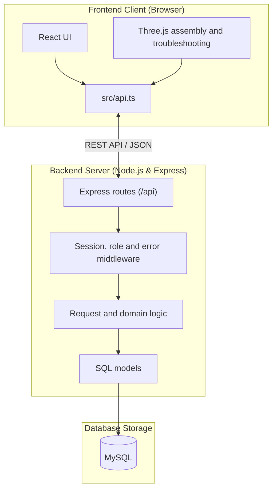
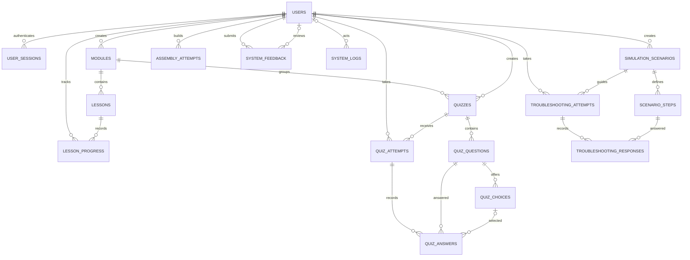

# PC-CRAFT: Interactive 3D PC Building Simulation & Troubleshooting Platform


**PC-CRAFT** is an interactive, web-based educational platform designed for learning computer hardware architecture, practicing hands-on 3D PC assembly, diagnosing real-world hardware/software faults, and taking structured learning modules and quizzes.

The system features real-time 3D rendering with component snapping, collision detection, compatibility verification, and interactive troubleshooting scenarios, backed by role-based access control (Student, Instructor, Admin) and progress tracking.

---

## 🛠️ Project Tech Stack

### **Frontend (Client)**
* **Core Technologies**: React, TypeScript, Vite, and CSS.
* **3D Graphics & Simulation**:
  * **[Three.js](https://threejs.org/)** (WebGL/WebGPU Rendering Engine).
  * **OrbitControls**: Smooth camera orbit, panning, zooming, and focal framing.
  * **GLTFLoader / DRACOLoader**: Optimized loading of 3D computer component models (`.glb` / `.gltf`).
  * **Raycasting & Collision Detection**: Interactive component picking, target slot highlight, socket compatibility check, and snap-to-place assembly.
* **Architecture**: React UI and Three.js assembly lab live in `client/frontend`; the UI calls the Express REST API through `src/api.ts`.

### **Backend (Server)**
* **Runtime**: **Node.js** (v22+).
* **Framework**: **Express.js** (RESTful API architecture).
* **Authentication & Security**:
  * **Bearer sessions**: Expiring sessions with token digests stored in MySQL.
  * **scrypt**: Salted password hashing.
  * **CORS & Helmet**: Security headers and cross-origin resource control.
* **Architecture**: Express routes mount API controllers; shared middleware handles bearer-session authentication, role checks, and errors. Controllers use SQL models and the MySQL connection pool. The implementation is in `server/routes/`, `server/controllers/`, `server/models/`, `server/middleware/`, and `server/config/`.

### **Database & Storage**
* **Database Engine**: **MySQL**.
* **Data Management**:
  * Raw relational schema (`database/schema.sql`).
  * Migration scripts (`database/migrations/`).
  * Seed data for initial modules, quizzes, and troubleshooting scenarios (`database/seeds/`).
* **Assets**:
  * Low-to-mid poly 3D assets in glTF 2.0 binary (`.glb`) format.
  * PBR textures (Albedo, Normal, Roughness, Metalness) for realistic hardware rendering.

### **Testing & DevOps**
* **Testing**:
  * Server unit & integration testing: Node test runner with MySQL (`server/test/`).
  * Client UI & simulation testing: **Vitest** / **Playwright** (`tests/client/`).
* **Environment**: Server configuration in `.env` (`.env.example`).
* **Agentic Support**: Custom AI workflow guidelines (`.agents/README.md`).

---

## 🏛️ System Architecture



The frontend is served by Nginx in Compose, which proxies `/api` to Express.
The API enforces authentication, role access, and ownership before SQL models
read or write MySQL. Build state and troubleshooting configuration are stored
as validated JSON alongside relational attempt records. Session tokens are
stored as hashes in `user_sessions`.

---

## 📁 Directory Structure

```text
pc-craft/
├── .agents/                                # AI agent guides and project rules
│   └── README.md
├── .env.example                            # Template for environment variables
├── .gitignore                              # Git exclusion rules
├── client/                                 # Frontend client application
│   ├── frontend/                           # React and Vite application
│   ├── pages/                              # Lab HTML stubs
│   │   ├── simulation.html
│   │   └── troubleshooting.html
│   ├── js/                                 # Lab script stubs
│   │   ├── simulation/
│   │   └── troubleshooting/
│   └── assets/
│       ├── ui_design/                  # UI wireframe mockups and screen references
│       ├── images/
│       │   └── logos/                      # Branding, UI icons & logos
│       ├── models/
│       │   └── glb/                        # 3D GLB component models (CPU, GPU, Case, etc.)
│       └── textures/                       # PBR material textures
├── database/                               # Database schemas, migrations, and seeds
│   ├── schema.sql                          # Primary relational schema definitions
│   ├── migrations/                         # Incremental database migrations
│   └── seeds/                              # Default seeds (admin user, modules, quizzes)
├── docs/                                   # Project documentation
│   ├── diagrams/                           # ERDs, wireframes, sequence diagrams
│   └── requirements/                       # SRS and technical specifications
├── server/                                 # Backend REST API server
│   ├── server.js                           # Express app entry point
│   ├── config/
│   │   └── db.js                           # Database connection pool setup
│   ├── routes/                             # API route definitions
│   │   ├── auth.routes.js                  # /api/auth
│   │   ├── module.routes.js                # /api/modules
│   │   ├── quiz.routes.js                  # /api/quizzes
│   │   ├── simulation.routes.js            # /api/simulation
│   │   ├── troubleshooting.routes.js       # /api/troubleshooting
│   │   ├── progress.routes.js              # /api/progress
│   │   ├── feedback.routes.js              # /api/feedback
│   │   └── admin.routes.js                 # /api/admin
│   ├── controllers/                        # Route business logic handlers
│   │   ├── auth.controller.js
│   │   ├── module.controller.js
│   │   ├── quiz.controller.js
│   │   ├── simulation.controller.js
│   │   ├── troubleshooting.controller.js
│   │   ├── progress.controller.js
│   │   ├── feedback.controller.js
│   │   └── admin.controller.js
│   ├── models/                             # Data models & SQL queries
│   │   ├── user.model.js
│   │   ├── module.model.js
│   │   ├── quiz.model.js
│   │   ├── choice.model.js
│   │   ├── simulationScenario.model.js
│   │   ├── simulationAttempt.model.js
│   │   ├── progress.model.js
│   │   ├── systemFeedback.model.js
│   │   └── systemLog.model.js
│   ├── middleware/                         # Express middlewares
│   │   ├── auth.middleware.js              # Bearer session verification
│   │   ├── role.middleware.js              # RBAC role guards
│   │   └── errorHandler.middleware.js      # Global error responses
│   └── services/                           # Auxiliary backend business services
├── tests/                                  # Automated test suites
│   ├── server/                             # API and unit tests for backend
│   └── client/                             # Frontend & simulation test suites
└── readme.md                               # Project documentation
```

---

## 🌟 Core Features & Modules

### 1. Interactive 3D PC Assembly Simulation
* Real-time 3D viewport featuring orbit, pan, and zoom controls.
* Step-by-step guidance or free-build mode.
* Part snapping to sockets (CPU into socket with orientation check, RAM into DIMM slots with latch clicks, GPU into PCIe slot, Motherboard into case standoffs).
* Compatibility checks (Socket type match, PSU wattage headroom, clearance checks).

### 2. PC Hardware & Software Troubleshooting Lab
* Realistic hardware and configuration error simulation:
  * No POST / Beep codes (missing RAM, unseated GPU, CPU 8-pin disconnected).
  * Thermal issues (forgotten thermal paste, fan header disconnected).
  * Boot failure (drive unformatted, boot order misconfigured).
* Multimeter and diagnostic checklist tools in virtual workspace.

### 3. Curriculum & Quiz Engine
* Structured learning modules with rich text, diagrams, and hardware guides.
* Timed or untimed quizzes with randomized multiple-choice and drag-to-match questions.
* Automated grading and explanation reviews.

### 4. Role-Based Access Control (RBAC)
* **Student**: Access learning modules, attempt 3D assembly and troubleshooting, take quizzes, view personal progress.
* **Instructor**: Monitor student performance, review attempt histories, assign specific scenarios and quiz deadlines.
* **Admin**: Manage users and roles, audit system logs, configure platform parameters, review user feedback.

---

## 🔑 Data Model and ERD

This ERD summarizes the implemented MySQL relationships. The authoritative
schema is [`database/schema.sql`](database/schema.sql), together with the
numbered migrations.



| Model | Description |
| :--- | :--- |
| Entity | Relationships and purpose |
| :--- | :--- |
| `users`, `user_sessions` | Learner/admin accounts and expiring, revocable sessions. Roles are `learner`, `admin`, and `super_admin`. |
| `modules`, `lessons`, `lesson_progress` | Learning content and per-user lesson completion state. |
| `quizzes`, `quiz_questions`, `quiz_choices` | Module-linked single-choice assessments and options. |
| `quiz_attempts`, `quiz_answers` | Per-user attempts, selected choices, grading, and scores. |
| `simulation_scenarios`, `scenario_steps` | Troubleshooting or maintenance scenarios and ordered prompts/actions. |
| `troubleshooting_attempts`, `troubleshooting_responses` | Scenario runs and responses associated with steps. |
| `assembly_attempts` | Assembly/disassembly build state and compatibility result. |
| `system_feedback` | User feedback and optional admin review. |
| `system_logs` | Actor-linked or system-level audit events. |

---

## 🚀 Getting Started

### Run with Docker Compose

Install Docker with the Compose plugin. If `.env` is missing, copy `.env.example`
to `.env` and set `DB_PASSWORD` and `MYSQL_ROOT_PASSWORD` to separate nonempty
values. From the repository root, run:

```bash
docker compose up --build -d --wait
curl --fail http://localhost:3000/api/health
```

Open http://localhost:3000. Nginx serves the React build and proxies `/api` to
Express on the Compose network. Compose uses port 5000 for Express inside the
network. MySQL remains accessible to local SQL clients on port 3307 by default.

MySQL applies numbered migrations on a fresh data volume. For an existing volume,
follow the [database upgrade instructions](database/README.md#manual-apply).
To populate lessons and quizzes, follow the [curriculum import instructions](database/README.md#import-the-curriculum).
Run `docker compose down` to stop the stack and keep the database volume.

### Run the app directly

#### Prerequisites
* **Node.js** (v22 or higher)
* **npm** (v9.0.0 or higher)
* **MySQL** (v8.0.16 or higher)
* A modern WebGL2-compatible browser (Chrome, Edge, Firefox, Brave)

#### 1. Environment Configuration
Copy `.env.example` to `.env` if needed. Set the database credentials and frontend origin. See the [API guide](server/README.md) for configuration and endpoints.

#### 2. Database Initialization
Start MySQL locally with the [database guide](database/README.md). To load the six modules, 25 lessons, and six quizzes, follow the [curriculum import instructions](database/README.md#import-the-curriculum).

#### 3. Server Setup
From the repository root:

```bash
npm --prefix server ci
npm --prefix server start
```

#### 4. Client Setup

Run the React client from the repository root:

```bash
npm --prefix client/frontend ci
npm --prefix client/frontend run dev
```

Open http://localhost:3000. Vite forwards `/api` to Express on
`127.0.0.1:5000`. See the [React client guide](client/frontend/README.md) for
production builds, the connected API routes, and the status of the lab pages.
